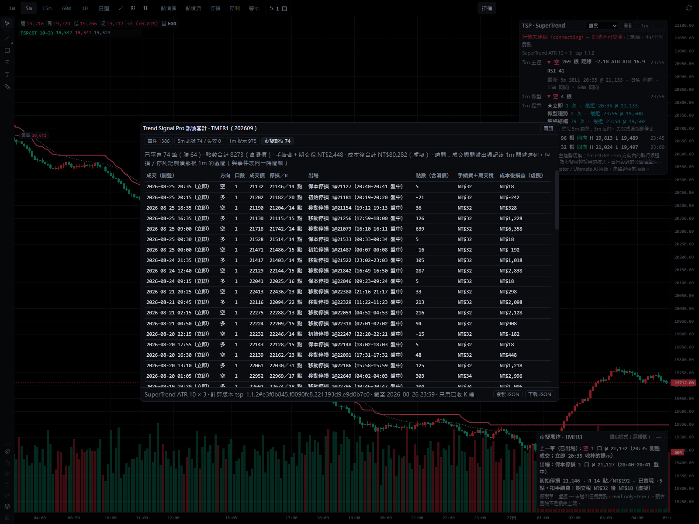
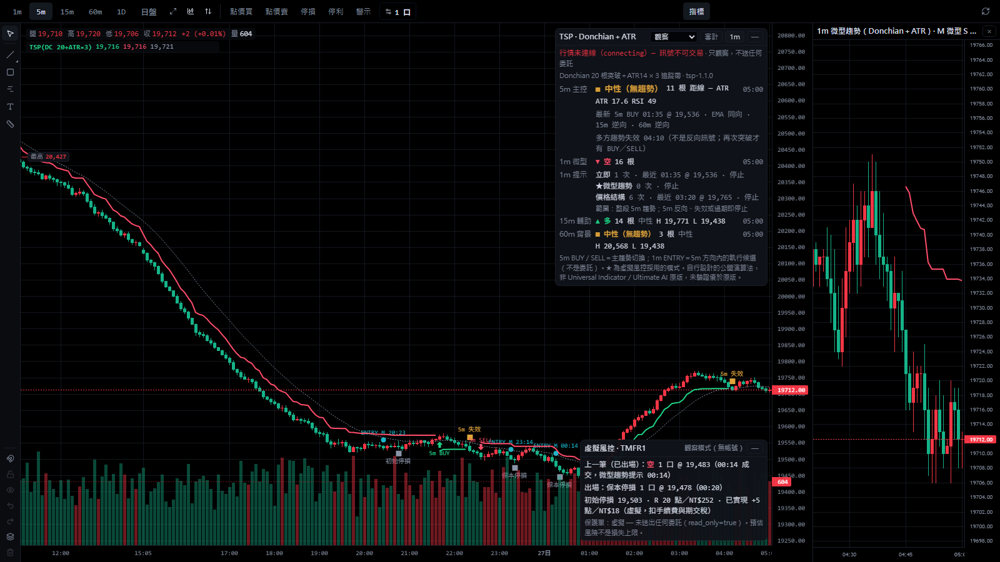
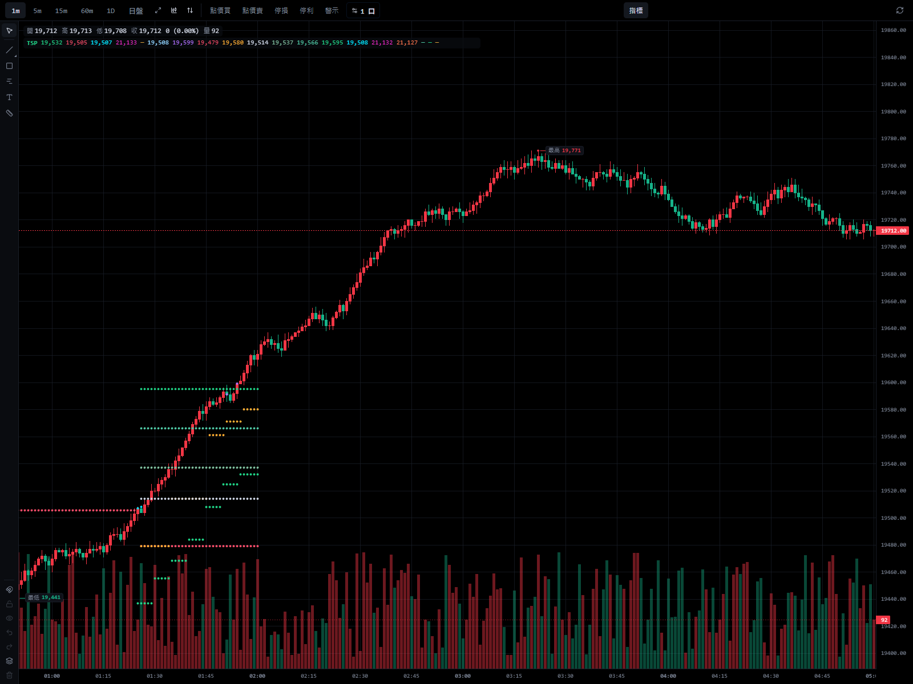
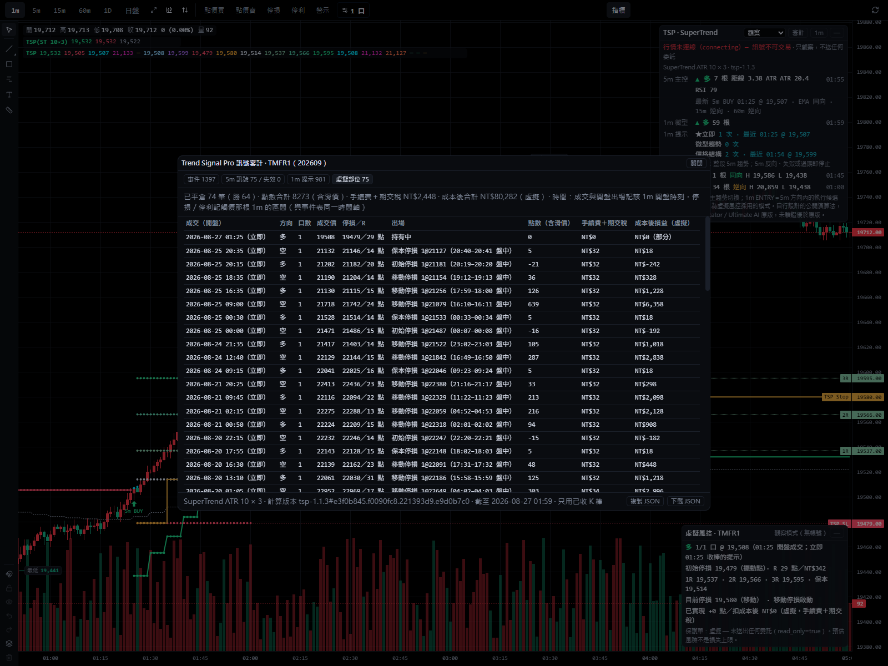

# Trend Signal Pro 使用說明

本分支提供 Web 完整審計介面與官方 App 自訂指標，兩者共用趨勢、進場與風控計算函式。原模型以5m 紅綠趨勢線與 BUY／SELL（主趨勢切換）為核心，1m 只在 5m 方向內提示執行時機，
15m／60m 只做輔助判斷；另有四週期面板、虛擬風控（SL／1R／2R／3R、保本、移動停損）與訊號審計。
計算版本 `tsp-1.2.0`，依 [V1.1 核心修正規格](design/trend-signal-pro-v1-1-core-correction.md)；此版依使用者決定把初始停損預設改為
5m 擺動點與 5m ATR（`stopTf=5`）、每筆預算預設 NT$2,500（量測報告結果 7）；保留 1.1.3 的缺棒取消進場與 1.1.2 的收棒涵蓋、回應順序與
多口成本修正，見[實作紀錄](design/trend-signal-pro-v1-impl.md)。

App 單檔為 **`tsp-app-1.4.0`**，依原意「5m 是主趨勢並判斷進出場，1m 是精準進出場」：1m 主圖跑原模型（與 Web 逐根相同）；
5m 主圖是同一條 5m 主趨勢，三核心 × 三進場模式與虛擬風控都以 5m K 棒計算；15m／60m／日K 只畫該週期趨勢線作輔助。



- **只觀察，不送任何委託**（`read_only = true`、`auto_entry = false`、`auto_exit = false`）。虛擬部位只是計畫，
  不是委託，也不是損益保證；預估風險不是損失上限。
- 自行設計的公開演算法（SuperTrend／KAMA＋ATR 遲滯／Donchian＋ATR 追蹤帶），**不是 Universal Indicator／Ultimate AI
  的原版或複製**，沒有 AI 模型。沒有原版可重現的訊號資料，**無法直接比較原版，也沒有驗證優於原版**。
- 設計與量測依據：[重設計提案](design/trend-signal-pro-v1-redesign.md)、[量測報告](research/trend-signal-algorithms-2026-10.md)
  （含 Gate 5 成本後公平比較）。




## 兩個介面，一套核心

- Web 用於回放、事件/部位審計、費稅與成本後損益、比較修改結果；需要檢討時再開。
- 官方 App 用於日常看盤，加入下面的單檔自訂指標，不需另建桌面程式或另外登入券商。
- App 腳本由 `src/lib/trend-signal/custom-entry.ts` → `app-custom.ts` 打包產生：1m 主圖呼叫與 Web 相同的 `runTrendSignal`，5m 與高週期用
  `chart-custom.ts`；都與 Web 共用 `trendTrack`、`computeEntries`、`risk/plan`、`risk/virtual`，沒有另一套手寫趨勢/風控公式。
  更新共用核心後執行 `npm run build:tsp-custom`；`npm test` 與 `npm run build` 會先檢查腳本是否落後來源，未同步便失敗。

## 在官方 App 直接使用（自訂指標版）

使用 [trend-signal-pro-custom.js](trend-signal-pro-custom.js)（`tsp-app-1.4.0`）。已建立指標的，到「自訂指標」清單點編輯，貼上新程式碼、
驗證、儲存即可；兩條提示輸出改名為 `微型提示`、`結構提示`（不再帶「1m」：5m 主圖上是 5m 提示），這兩條的樣式會回到預設，其餘 17 條保留。
沒有的，新建名稱 `TSP 微台`、縮寫 `TSP`、位置「主圖疊加」。

App 只把主圖本身的 K 棒交給自訂指標，所以依主圖週期：

| 主圖 | 趨勢線、BUY／SELL、失效 | 微型／結構提示 | 虛擬進出場與風控 |
|---|---|---|---|
| **1m（建議）** | 5m 主趨勢（由 1m 聚合，與 Web 相同） | 有：5m 方向內的 1m 精準進場時機 | 原模型：提示的下一根 1m 開盤成交；初始停損依已收 5m 的擺動點與 ATR（`stopTf=5`），觸價逐根 1m 判定；與 Web 逐根相同 |
| **5m** | 同一條 5m 主趨勢，BUY／SELL 與 1m 主圖相同 | 有：以 5m K 棒算的微型趨勢與價格結構（看不到 5 分鐘內的回檔，比 1m 主圖少、晚） | 三種進場模式都有：提示的下一根 5m 開盤成交；「立即」與 1m 主圖同一時刻、同一價格、同一個初始停損與 R；停損、保本、停利以 5m K 棒判定，棒內先後未知時停損優先 |
| **15m／60m／日K** | 只有該週期自己的趨勢線（高週期輔助），沒有 BUY／SELL | 無 | 無：拿不到 5m 主趨勢，不另算一套部位 |

5m 主圖的微型趨勢與主趨勢算在同一組 5m K 棒上，沿用 1m 主圖的微型預設會與主趨勢完全相同、永遠不提示。所以 5m 主圖沒有宣告微型參數時，
改用 5m 預設：SuperTrend 倍數 `microStMult=1`、Donchian `microDcLength=5`、KAMA 遲滯 `microKamaHyst=0.05`（只依提示頻率選，
量測報告 7.3；仍只有 1m 主圖的 14–65%）。宣告了就照用；宣告成 1m 預設（3／20／0.3）時 5m 主圖不會有微型提示。

| 圖上輸出（19 條） | 樣式與說明 |
|---|---|
| 多方/空方趨勢線 | 綠/紅色實線，只畫最後一段連續有效趨勢（宿主會跨空值把不同歷史段接起來） |
| BUY/SELL、失效 | 圓點：5m 主趨勢切換／轉 NEUTRAL，不是虛擬成交或行情連線狀態 |
| 微型提示、結構提示 | 圓點：5m 方向內的候選進場時機（1m 主圖是 1m 提示、5m 主圖是 5m 提示），尚未虛擬成交 |
| 初始停損、目前停損、保本價 | 紅/橘/灰價位線；**目前停損需手動選階梯線**，按 stopHistory 生效棒更新，不回填最後值 |
| 1R、2R、3R | 綠色系價位線，以虛擬成交後固定的 R 計算 |
| 虛擬進場多、虛擬進場空 | 青/洋紅圓點，畫在成交那根 K 棒，數值是含滑價的虛擬成交價 |
| 虛擬停損出場、虛擬2R出場、虛擬3R出場、虛擬反轉失效出場 | 按出場原因分列，同根 2R/3R 不互相覆蓋；停損列包含初始、保本與追蹤停損 |

預設只畫目前尚未平倉的虛擬部位風控，平倉後清除，歷史進出場點仍保留。橘色階梯線就是目前生效停損，包含初始、保本與移動階段。
需要查歷史價位時設定 `riskHistory=1`（預設0），並將六項風控改回圓點，避免跨部位接線。
官方自訂API沒有文字箭頭、逐點顏色或自動階梯預設。現有App可使用線/點、輸出名稱的滑鼠提示，以及「價格軸最新值標籤」；**不能宣稱已在每根K棒旁寫出進出場文字**。
App 沒有完整 Dashboard、成本後損益表、審計、資料凍結或額外 LIVE/過期徽章。它不讀實際帳戶/委託/成交，不自動掛單或修改停損單。

以下兩張是 1.1.3 的合成回放紀錄（1m 主圖；當時初始停損依 1m，本版預設依 5m），不是實際績效或原生App截圖：





### 預設商品、費用與參數

腳本的預設明訂為微台模型：`tick=1`、`pointValue=10` 元/點、`taxRate=0.00002` 單邊；單邊手續費 `feePerSide=12` 元/口，滑價 `slipTicks=1` tick/邊。
**自訂 API 不提供商品代碼或契約規格，腳本不會自動辨識主圖商品。** 套在非微台圖表前，必須人工核對並設定上述商品參數；未知規格不應套用。
非法或非有限的規格/參數會報錯。輸入規格是虛擬模型設定，不代表已驗證的券商成交條件。

與 Web 使用同一份 `configFromParams`：原有 `algo`、趨勢/提示參數都保留；另支援 `entryMode`、`budget`、`qty`、`feePerSide`、`slipTicks`、
`stopTf`、`swingBars`、`stopAtr`、`trailAtr`、`singleExit`、`tierMode`、`tp2Lots`、`tp3Lots`。預設風險預算 2,500 元、初始停損依 5m（`stopTf=5`；
`stopTf=1` 是 1m 原規則）、最多1口、單口追蹤，全部只是虛擬計畫。之前在 App 宣告過 `budget=1000` 的，請改成 2,500 或刪掉該參數
（App 只送出你宣告的參數，不會自動升級）。
`riskHistory` 只控制顯示，不改核心交易計算；它只接受0或1。完整代號/預設與範圍見 [config.ts](../src/lib/trend-signal/config.ts) 的 `TSP_PARAMS`；商品參數 `tick/pointValue/taxRate` 可另加於自訂指標參數表。
宿主沒有傳主圖週期，預設依時間間距推斷；資料稀疏造成推斷有歧義時，可新增 `chartTf` 數值參數（0 自動；1／5／15／60／1440），手動固定後換週期須同步調整。

### 建立步驟

1. 把 `docs/trend-signal-pro-custom.js` 的內容複製到剪貼簿（Windows 的檔案若是舊 checkout，先更新此單檔）。
2. 官方 App 選微台、**1m 主圖**（建議）、全盤；K 線面板「指標」→「自訂指標」：已有 TSP 指標（1.1.3 起）就點編輯，否則「建立自訂指標」。
3. 名稱/縮寫如上，位置「主圖疊加」；新建時刪除範例參數 fast/slow。使用預設時不用新增參數。
4. 程式碼欄貼上 →「驗證」，應偵測 **19 條輸出** →「儲存」，再從自訂清單加入圖表。
5. 「樣式」：多方/空方趨勢線選「線」；「目前停損」選「階梯線」；初始停損、保本、1R/2R/3R選「線」；其餘進出場/提示選「圓點」。
6. 「時框顯示」：1m 與 5m 有訊號與進出場；15m／60m／日K 只顯示輔助趨勢線，依需要勾選。

### Web 對照與已知限制

- 1m 主圖與 Web 原生逐根相同的條件：同一份 1m、同一個資料起點（App 只用主圖已載入的資料，最前面約 750 根 1m 是暖身）、同參數與商品規格、
  同計算時刻。`custom-script.test.ts` 以 App 執行器跑產物，三核心 × 三進場模式逐值比對。
- 5m 主圖：趨勢、BUY／SELL，以及立即進場的時刻、成交價、初始停損與 R 和 1m 主圖相同（兩者都依已收 5m）；之後的停損、保本、停利以 5m K 棒判定，
  部位結果可能與 1m 主圖不同，以 1m 主圖為準。微型趨勢與價格結構的提示來自 5m K 棒，與 1m 主圖的提示不是同一組。
  5m K 棒看不出缺了哪幾分鐘，不做完整性檢查（1m 主圖會排除缺分鐘的 5m）。
- 已收判定：盤中最後一根等下一根出現才確認；盤末等收盤＋240 秒定盤寬限再 10 秒（本機時鐘）。日K以日曆日結束加 10 秒確認。
  **沒有 Feed 凍結**：更新歷史、晚到成交、載入更多歷史或換參數都會重算；Web 的即時 Feed 與 App 主圖資料可能不同。
- 進行中 K 棒只允許開盤成交與保護停損，不提前觸發目標或移動停損。下一根預期 K 棒缺資料時取消進場、不延後成交。
- 開「僅日盤」會改變計算輸入。App日K是宿主提供的日曆日資料，不是期交所交易日。
- Web 審計用來找資料、時間、成本與風控問題；策略改善仍需固定設定與成本後驗證。tsp-1.2.0 的停損與預算預設以兩年行情重新量測（量測報告結果 7）。

## Web 完整介面加入圖表

1. K 線面板工具列 →「指標」→ 搜尋 `TSP` 或「趨勢訊號」→ 點「Trend Signal Pro 趨勢訊號」。
2. 設定視窗可先調參數（圖上即時預覽），按「確定」加入。
3. legend 顯示 `TSP(ST 10×3)`（Donchian 為 `TSP(DC 20+ATR×3)`）；眼睛圖示可隱藏，隱藏時面板與標記一起消失。

同一張圖以第一個可見的 TSP 實例驅動面板與標記。組合商品沒有單一合約的 1m K 棒，不支援。

## 畫面

| 位置 | 內容 |
|---|---|
| 主圖 | 5m 趨勢線（綠＝LONG、紅＝SHORT；翻轉與失效處斷開，NEUTRAL 沒有線）、5m EMA 註記線（虛線）、`5m BUY`／`5m SELL` 箭頭、`5m 失效` 方塊、風控採用模式的 1m 提示（`ENTRY M 09:13`＝模式代號＋原始 1m 觸發時間）、虛擬出場點、持倉中的 SL／1R／2R／3R 與動態停損（橘色階梯線） |
| 右上 Dashboard | 演算法參數與計算版本；5m 主控（狀態、持續根數、距線 ATR、ATR、RSI、最新訊號與註記、失效說明）；1m 微型趨勢；各模式的 1m 提示（★＝風控採用：本段次數、最近一次時間與價格、已停止與否，滑鼠停留看目前在等什麼）；15m 輔助／60m 背景（同向／逆向、近 20 根高低點）；每列右側是最後一根已收 K 棒的時間，盤中該週期缺了前一根時標「過期」、最後一根缺 1m 時標「缺資料」（15m／60m 只標示）；高週期都與 5m 反向時顯示「高週期逆向」；最近 30 分鐘有 5m 因缺分鐘被排除時顯示警告；有晚到成交被忽略時顯示筆數；逐筆累計量接不上（中間漏收）時顯示次數 |
| 右下虛擬風控 | 方向、口數、成交價與成交時刻（`HH:MM 開盤`）、初始停損與依據、R（點數／新臺幣）、1R／2R／3R、保本價、目前停損、未實現／已實現（虛擬，扣手續費與期交稅）、5m 反向或失效待平倉、警告 |
| 右側 1m 小圖 | Dashboard「1m」按鈕開關；最近 120 根 1m、1m 微型趨勢線（與 5m 同一演算法）、5m 訊號與失效、M／S／K 提示點 |
| 審計 | 事件（時間＝實際發生的時刻，含 `DATA` 資料缺口）、5m 訊號／失效、1m 提示、虛擬部位四個分頁。虛擬部位分頁：成交（開盤）時間、出場（`HH:MM 開盤` 或 `HH:MM–HH:MM 盤中`）、點數（含滑價）、手續費＋期交稅、成本後損益，上方是已平倉合計。「複製 JSON」「下載 JSON」含演算法參數、完整設定、時間慣例、成本後合計與資料缺口，可離線檢查 |

5m BUY／SELL 是主趨勢切換；1m ENTRY 是 5m 方向內的執行候選，不是委託，也不是另一組 BUY／SELL。

狀態徽章：`LIVE`（行情連線中）、`行情未連線 — 訊號不可交易`、`休市`、
`資料補齊中：HH:MM 起尚未確認`（斷線重連後、或某分鐘不在即時資料涵蓋內：等伺服器歷史補到該分鐘才確認之後的 K 棒，期間不產生新訊號）、
`確認延遲 N 秒`（最後確認的分鐘落後現在超過 180 秒）、`資料延遲 N 秒`（盤中超過 180 秒沒有新的已收 1m）、
`無新資料（可能休市）`（盤中時段超過 30 分鐘沒有資料，例如國定假日；時段判定不知道假日）。
Dashboard 與虛擬風控面板都可按「—」收合。

切換主圖 1m／5m／15m／60m 不會改變任何訊號：所有計算都來自同一份固定 20 天的 1m 資料，主圖週期只決定標記落在哪一根 K 棒，
1m 提示的文字保留原始觸發時間。日 K 不畫趨勢線與標記（Dashboard 照常）。開「僅日盤」時，夜盤的訊號沒有對應的 K 棒，不畫。

## 訊號規則（TrendCore）

- **只用已收 K 棒，以資料進度確認**：1m label ≤ asOf 才算已收，asOf 由資料決定、不由時鐘推算。伺服器歷史涵蓋到請求時間 − 10 秒；
  之後的分鐘必須在連續接收逐筆的期間內，收到交易所時間已跨過該分鐘的成交才算收完；心跳只判斷連線健康，不用本機收到時間推進確認。
  「連續接收」以兩件事判斷：接收起點取第一筆成交的交易所時間（本機時鐘偏慢也不會把開始接收前的分鐘算進來），且每筆的當日累計成交量
  必須接得上（上一筆累計＋本筆量＝本筆累計）。接不上代表中間有成交沒收到（SSE 沒斷，但上游斷線或訂閱被丟），從那一筆重新起算。
  斷線重連、隱藏指標或切到不顯示指標的週期、累計量接不上之後，漏收期間與兩端的分鐘要等自動補抓的伺服器歷史涵蓋才確認
  （徽章「資料補齊中」）。補抓從第一個待補分鐘的前一天抓起（隱藏或斷線超過一天也補得回來，最多回推 20 天），每次都是新的請求、
  不寫入主圖的歷史快取；伺服器回空資料不算涵蓋。5m／15m／60m 由同一份 1m 以主圖相同的規則聚合，桶收完（或該盤收盤）才算已收。
  進行中的 K 棒不參與任何訊號。
- **已確認的分鐘凍結**：之後晚到的同分鐘成交不再改寫 K 棒（Dashboard 顯示忽略筆數），「更新歷史」也不改寫已確認的分鐘；
  已出現的訊號、失效、提示與虛擬成交因此不會被資料更新改寫。
- **資料完整性**：5m 桶內每個正規交易分鐘（日盤 08:46–13:45、夜盤 15:01–05:00）都要有 1m 才參與計算。缺任何一分鐘的 5m 排除
  （審計記一筆 `DATA` 事件），不參與趨勢計算，也不產生訊號、提示或虛擬進場；5m 桶內出現缺口之後的 1m 不提示；缺口之後到下一根
  完整的 5m 收盤前，5m 狀態過期，也不提示。缺分鐘可能是斷線、上游缺料，也可能是冷清時段真的沒有成交，程式無法分辨，一律排除。
  TMF 兩年有 0.62% 的 5m 桶因此排除，多數在夜盤 02:00–05:00（量測報告結果 6 §0）。15m／60m 缺分鐘只標「缺資料」，不排除。
- **四種狀態**：LONG、SHORT、NEUTRAL（已知、沒有趨勢；只有 Donchian＋ATR 會出現）、UNKNOWN（暖身）。
- **BUY／SELL**：已收 5m 由 SHORT／NEUTRAL 進入 LONG＝BUY、由 LONG／NEUTRAL 進入 SHORT＝SELL；每次狀態切換只產生一個
  事件，產生後不再改變。前一根是 UNKNOWN 時不知道之前的狀態，不算切換。
- **失效**：LONG／SHORT → NEUTRAL 是「趨勢失效」事件，不是反向訊號；之後要再次突破才有 BUY／SELL。
- **暖身**：資料起點後 SuperTrend 15 × ATR 週期、KAMA 5 × 慢速常數、Donchian 週期 + 120 根（預設 150／150／140）輸出
  UNKNOWN，不產生訊號（真實 TMF 5m 量測的收斂根數見量測報告結果 3）。
- **訊號 ID**：`計算版本#趨勢參數指紋 | 商品 | 月份 | 盤別 | 5m | 收棒時間 | BUY/SELL/INVALID`。改進場或風控參數不改訊號 ID。
- **高週期（MtfContext）**：每個時點只看當時已收的 15m／60m；換盤後尚未收第一根、或資料缺洞時標「過期」。只是註記，不否決 5m。
- **註記（不影響訊號）**：EMA21 同向／逆向、15m／60m 同向／逆向。

三個候選（參數可調，量測都用同一份資料與成本；不指定最佳）：

| ID | 演算法 | 規則 | TMF 5m 兩年量測（訊號/日、趨勢段中位、延遲中位；樣本內～樣本外） |
|---|---|---|---|
| A（預設） | SuperTrend(10,3) | (H+L)/2 ± 倍數 × ATR 的棘輪帶，收盤穿越即翻轉 | 5.8–5.9／日、29–30 根、10–11 根（4.1 ATR） |
| B | KAMA(10,2,30)＋遲滯 0.3 | 自適應均線自身回落（回升）超過遲滯 × ATR14 才翻轉；線不是停損價位 | 7.1–7.2／日、23–24 根、10 根（3.6–3.7 ATR） |
| C | Donchian(20)＋ATR×3 | 收盤突破前 20 根極值轉 LONG／SHORT；近 20 根極值 ∓ 3 × ATR14 的追蹤帶，收盤穿越即 NEUTRAL | 6.9／日（另有失效 5.3–5.4／日）、17 根、6–7 根（3.3 ATR） |

## 1m 進場提示（EntryTiming）

**範圍**：預設整段 5m 同向狀態都可提示，直到 5m 反向、失效或 UNKNOWN；「進場｜提示範圍」設 N 時只取翻轉後 N 根 5m
（post-flip window，不跨盤）。5m 狀態過期（換盤後第一根 5m 收棒前、資料缺洞）、5m 桶內已缺 1m 之後、每盤最後一根 1m 不提示。

| 模式 | 規則 |
|---|---|
| **立即**（預設，比較基準） | 5m 收棒即提示一次 |
| **微型趨勢** MICRO_TREND | 1m 微型趨勢（與 5m 同一演算法，靈敏度參數獨立）由反向或中性轉回與 5m 同向時提示；一段趨勢可多次。1m 雜訊比 5m 多 |
| **價格結構** PRICE_STRUCTURE | 回檔轉折（左右各 2 根，右側收盤後才確認）確認後，收盤突破回檔起點時提示；提示後要有新的回檔轉折才會再提示 |
| 先前策略假說／未驗證（可選，預設 OFF） | EMA9／VWAP 回測＋KD 交叉，參數固定；只有「風控採用」選它時才計算 |

立即、微型趨勢、價格結構三種一律計算並列在 Dashboard 與審計；「進場｜風控採用」只決定虛擬部位用哪一種。

量測（TMF 兩年、成本後，詳見量測報告結果 6、7）：等待確認的模式第一次提示的平均價位都比 5m 收棒立即差（−0.4 至 −1.2 ATR）；
搭配 tsp-1.1.x 的 1m 停損時，各模式的成本前每筆損益都接近 0（−24～+26 元；每口來回成本 52–62 元：手續費 24、滑價 20、期交稅 8–18），提示越多成本拖累越大。
tsp-1.2.0 的 5m 停損＋NT$2,500 與舊預設相比，樣本內、外各 7/9 組每筆較好、9 組合計虧損少 41–46%，但 1m 主圖 18 格仍全部為負；
定案後才抓的新資料（2026-09-01 之後 33 個交易日，量測報告結果 8）每筆較好只有 3/9，合計虧損較少只因筆數較少，**新資料不支持這次改動**；
使用者看過後決定保留 tsp-1.2.0（三段期間合計虧損都較少、5m 結構停損符合原意），但每筆改善不是已確認的結論。
**沒有一種時機或核心在成本後有可分辨的優勢**；預設採用「立即」只因為它是比較基準，不代表比較好。

出場：5m 確認反向或失效 → 下一根 1m 開盤平倉，不等 1m；停損、保本、移動停損觸價即出（含進行中的 K 棒），永遠獨立有效；
持倉中 1m 微型趨勢反向只顯示警告。

## 虛擬風控（RiskPlanner）

- 初始停損（預設 `stopTf=5`）：多單 `min(提示當下已收的最近 5 根 5m 確認擺動低點 − 1 tick, 進場 − 1.5 × 5m ATR14)`，空單鏡像；
  `stopTf=1` 改用 1m 的擺動點與 ATR（規格 §2 原規則）。R 以成交價重新定價後固定。5m 停損的 1 口風險約是 1m 的 2 倍
  （TMF 樣本外中位 NT$766–1,094、P90 NT$1,822–3,280，量測報告 7.2）。
- 每筆預算 NT$2,500（全部口數合計，含來回手續費、滑價緩衝與期交稅）；超過預算減口數，連 1 口都不行時拒絕並說明原因
  （TMF 兩年：樣本內 0.1–1.3%、樣本外 3–17% 的提示 1 口就超過）。
- 每點價值：API 的 `multiplier` 優先，其次已知根代碼（TMF 10、MXF 50、TXF 200）；都沒有就不產生風控計畫。
- 期交稅：股價指數類期貨單邊 0.00002 × 契約價值（元以下四捨五入），計入保本價與已實現損益。
- +1R：停損移到保本（成交價 + 來回成本折算點數），下一根生效；+2R：啟動移動停損、多口時出第 1 層；+3R：多口時出第 2 層。
- 移動停損：`max(舊停損, 5m 趨勢線 − 1 tick, 入場後最高 − 1.2 × 5m ATR14)`，只往有利方向；KAMA 的線不是停損價位，只用 ATR 項。
- 口數分層：1 口追蹤（可改 2R／3R 全出）、2 口 2R＋追蹤、3 口 2R＋3R＋追蹤、4 口以上可自訂；不產生零口或超賣。
- 虛擬成交：提示的下一根 1m 開盤 ± 滑價（成交 K 棒已到下一盤就取消）；停損跳空以開盤價成交；同一根同時觸及停損與目標時停損優先。
- 同一段趨勢多次提示：持倉或待成交時略過（不加碼），停損出場後下一次提示可再進場。
- 審計時間：一律是事件實際發生的時刻。開盤成交（進場、5m 反向／失效平倉、停損跳空）記成交那根 1m 的開始時間，顯示 `HH:MM 開盤`；
  盤中觸價（停損、停利）顯示那根 1m 的區間 `HH:MM–HH:MM 盤中`，事件時間記在區間結束。例：22:50 收棒的提示在下一根 1m
  （22:50–22:51，圖上標 22:51）開盤成交，事件表與部位表都是 `22:50 開盤`。JSON 匯出的 K 棒時間（`barTime`、`fills[].time`）仍是
  收盤 label，`timeConvention` 欄位有說明。
- 損益：點數（含滑價）是成本前；成本後＝點數 × 每點價值 − 手續費 − 期交稅（新臺幣）。部位表逐筆列出兩者，上方是已平倉合計。

## 模式

| 模式 | 行為 |
|---|---|
| 觀察（預設） | 只顯示 |
| 模擬警示 | 行情 LIVE、盤中、3 分鐘內的新 5m 訊號／5m 失效／風控採用模式的 1m 提示／虛擬成交／出場發 App 通知；已提醒過的不重複（切週期、重開都一樣） |
| 模擬交易 | 停用（P4 未授權） |
| 正式交易 | 停用（V1 不開放） |

## 參數

設定視窗「輸入」分頁，依前綴分組（括號內為預設）：

- 趨勢：演算法（0 SuperTrend／1 Donchian＋ATR／2 KAMA）、SuperTrend ATR 週期（10）／倍數（3，小＝快）、Donchian 突破週期（20）／
  ATR 追蹤帶倍數（3）、KAMA 效率比週期（10）／快速（2）／慢速（30）／翻轉遲滯（0.3 × ATR）。
- 註記：EMA 週期（21，只標示）。
- 進場：風控採用（0 立即）、提示範圍（0＝整段 5m 趨勢；N＝翻轉後 N 根 5m）、1m 微型趨勢 SuperTrend 倍數（3）／
  Donchian 週期（20）／KAMA 遲滯（0.3）、結構轉折左／右（2／2）、最小回檔（0.5 × 1m ATR）。
- 風控：預算（NT$2,500）、單邊手續費（NT$12）、滑價緩衝（1 tick／邊）、口數上限（1）、初始停損週期（5＝5m；1＝1m）、擺動點 K 棒數（5，停損週期的 K 棒）、
  停損 ATR 倍數（1.5，停損週期的 ATR14）、移動停損 ATR 倍數（1.2）、單口出場（1 追蹤）、多口分配（0 規格表）、自訂 2R／3R 口數。

1m 微型趨勢沿用 5m 的演算法，只換該演算法的靈敏度參數（SuperTrend 倍數、Donchian 週期、KAMA 遲滯）；ATR 週期等其餘參數與趨勢設定相同。
不同商品的手續費請自行覆寫（預設值是 TMF 的單邊 NT$12）。

V1.0 已存的實例：「提示範圍」與「1m 微型趨勢倍數」在 V1.1 換了參數鍵（`hintWindow`、`microStMult`），舊實例的 15 分鐘窗口與倍數 1
不會沿用，升級後是 V1.1 預設（整段趨勢、倍數 3）。

tsp-1.2.0 之前存的 Web 實例（沒有 `stopTf`）：載入時補上 `stopTf=5`；預算仍是舊預設 NT$1,000 的升到 NT$2,500，改過的預算保留。
升級只做一次，之後改回 NT$1,000 也照用。「存為我的預設」存下的舊預設同樣處理。

## 已知限制

- 歷史固定載入 20 個日曆日的 1m；60m 需約 8 個交易日暖身才有方向。
- 即時 1m 由 SSE 逐筆成交組成，確認後凍結。之後伺服器歷史若與即時組出的 1m 不同（晚到成交、上游修正），畫面不改寫；
  重開 App 會從伺服器歷史重新計算，結果可能與當時畫面不同。需要保留當時的紀錄時，先用審計「下載 JSON」。
- 嚴格完整性的代價：冷清時段沒有成交的分鐘也會讓整根 5m 排除，這段時間的訊號會延後或不出現（主要在夜盤 02:00–05:00）。
- 確認延遲：成交頻繁時下一筆成交即確認；安靜市場在分鐘結束 45 秒後補抓歷史（兩次補抓至少間隔 15 秒），補抓成功且涵蓋後才確認。
  即使心跳正常也不跳過補抓；若補抓失敗，繼續等待，沒有固定的最長確認時間。午休、隔夜與週末會跳過非交易分鐘，再判斷是否需要補抓。
- 本機時鐘仍用於歷史請求時間與補抓排程；10 秒緩衝不能保證容忍任意時鐘偏差，請保持電腦時間自動校時。
- 隱藏後重新顯示會保留已凍結資料，但重新起算逐筆接收涵蓋；舊快取、已失效請求及反向完成的較舊歷史回應不能越過漏收區間。
- 每次重新起算（開啟、重新顯示、重連、累計量接不上）後，跨在接收起點上的那一分鐘不能靠逐筆證明完整，要多等一次補抓（約 10–20 秒）。
- 累計量檢查依賴 SSE 逐筆的 `total_volume`；缺這個欄位時只能看成交時間，無法發現 SSE 沒斷時的漏收。
- 多口分批出場時，進場稅按累計已平倉口數分配，最後加總等於模型中整筆進場口數取整的稅額；尚未與真實券商帳單比對取整方式。
- 整根 5m 都沒有 1m（例如整段夜盤沒有資料）時不另記 `DATA` 事件；這段期間 5m 過期，不產生提示。
- 斷線補齊後才確認的事件，與即時確認的事件在畫面上沒有區別（審計時間仍是 K 棒時間）。
- 換月：連續月代碼（如 TMFR1）的 1m 由伺服器提供，換月跳空會反映在指標上；訊號 ID 記錄當時的月份。
- 量測只涵蓋 TMF 兩年（樣本內 2024-09～2025-08、樣本外 2025-09～2026-09），不代表其他商品或盤勢；虛擬部位以 1m OHLC 模擬，
  不含真實成交、部分成交、排隊或委託回報。
- 既有 Gate 5 表格（結果 6）仍是 `tsp-1.1.1` 的歷史量測；結果 7（風控模型、5m 主圖、新預設）以 tsp-1.1.3／1.2.0 的程式量測，
  未證明任何交易優勢。
- 既有內建「SuperTrend 超級趨勢」指標的多空兩線在翻轉處會互相連線（lightweight-charts v5 的折線不因 whitespace 斷開，
  改動前即存在）；Trend Signal Pro 已用點顏色斷線，內建指標未修改。

## Windows 建置與使用

這個 repo 是開源的 Web 版終端。官方桌面版安裝檔（.msi）內含的是上游前端，看不到這個分支的 Trend Signal Pro；
桌面版需要私有 repo `shioaji-pro-desktop` 與簽章金鑰才能建置，本 fork 無法自行產出。要在桌面版使用，需把本分支
送 PR 到上游 `Sinotrade/shioaji-pro-app`，由維護者合併發版。以下是在 Windows 上使用 Web 版的方式。

前置：

1. Node.js 22 LTS、Git、pnpm 10。
2. 一個本機 Shioaji server（二擇一，建議先用模擬環境）：
   - 已安裝並登入的 Shioaji Pro 桌面版：內建 server 在 `127.0.0.1:21322`（Web 版預設就連這裡）。
   - Shioaji CLI 1.7.8（與 repo 的 `SHIOAJI_VERSION` 相同）：`uv tool install shioaji==1.7.8`，在 repo 根目錄
     `.env` 填 `SJ_API_KEY`／`SJ_SEC_KEY`，執行 `shioaji server start`（預設模擬環境、port 8080）。

**CLI**（Windows PowerShell）

```powershell
winget install OpenJS.NodeJS.LTS
winget install Git.Git
npm install -g pnpm@10
git clone https://github.com/Zongc-spec/shioaji-pro-app.git
cd shioaji-pro-app
git checkout codex/trend-signal-pro-v1
pnpm install --frozen-lockfile
pnpm test
pnpm build
# 連 Shioaji Pro 桌面版內建 server（127.0.0.1:21322）
pnpm dev
```

已 clone 過的話，更新到最新版：

**CLI**（Windows PowerShell）

```powershell
cd shioaji-pro-app
git checkout codex/trend-signal-pro-v1
git pull --ff-only
pnpm install --frozen-lockfile
pnpm dev
```

使用 CLI server（port 8080）時，改用：

**CLI**（Windows PowerShell）

```powershell
$env:VITE_API_TARGET = 'http://127.0.0.1:8080'
pnpm dev
```

瀏覽器開 `http://127.0.0.1:5173`，在 K 線面板加入 Trend Signal Pro。

也可以把 build 結果上傳給 CLI server 代管（依 README「Deploy as a Shioaji custom app」；上傳的 App 存在 server
記憶體，server 重啟後要重傳；此流程本次未在本機實測）：

**CLI**（Windows PowerShell）

```powershell
$env:VITE_BASE = '/apps/shioaji-pro-app/'
pnpm build
$files = Get-ChildItem dist -File | ForEach-Object { '-F'; "files=@$($_.FullName)" }
curl.exe -X POST http://127.0.0.1:8080/api/v1/apps/shioaji-pro-app @files
# 開啟 http://127.0.0.1:8080/apps/shioaji-pro-app/index.html
```

在 WSL 內開發時，WSL 預設的 NAT 網路連不到 Windows 端只聽 `127.0.0.1` 的桌面版 server；請在 WSL 內另跑 CLI server，
Windows 瀏覽器開 `http://localhost:5173`（WSL 會把 localhost 轉給 Windows）：

**WSL**

```bash
cd ~/shioaji-pro-trend-v1
npx -y pnpm@10 install --frozen-lockfile
VITE_API_TARGET=http://127.0.0.1:8080 npx -y pnpm@10 dev
```

不連任何 server、只看畫面時，可用回放展示頁（合成資料；`TSP_DEMO_DATA` 可指向自備的 kbars JSON；網址加 `&p.algo=1`
切 Donchian＋ATR、`&p.entryMode=1` 讓風控採用微型趨勢）：

**WSL**

```bash
cd ~/shioaji-pro-trend-v1
npx vite --config scripts/tsp-demo/vite.config.ts --port 5298 --host 127.0.0.1
# Windows 瀏覽器開 http://localhost:5298/?theme=dark&replayAt=2026-08-27T05:00:30&mini=1
```
