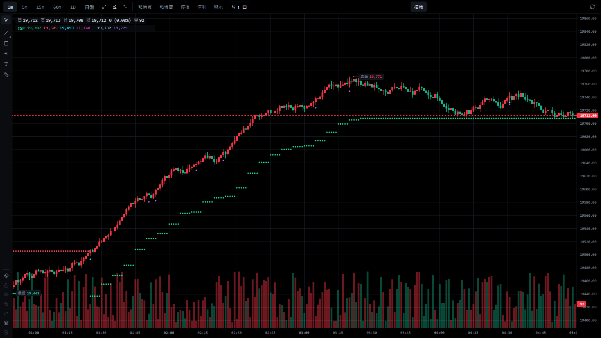

# Trend Signal Pro 使用說明

Shioaji Pro 的原生內建指標：5m 紅綠趨勢線與 BUY／SELL（主趨勢切換）為核心，1m 只在 5m 方向內提示執行時機，
15m／60m 只做輔助判斷；另有四週期面板、虛擬風控（SL／1R／2R／3R、保本、移動停損）與訊號審計。
計算版本 `tsp-1.1.1`，依 [V1.1 核心修正規格](design/trend-signal-pro-v1-1-core-correction.md)；1.1.1 是 2026-10-21 審查退回後的修正
（資料不完整的 5m 排除、即時資料以資料進度確認並凍結、審計時間與成本後損益），見[實作紀錄](design/trend-signal-pro-v1-impl.md)。

- **只觀察，不送任何委託**（`read_only = true`、`auto_entry = false`、`auto_exit = false`）。虛擬部位只是計畫，
  不是委託，也不是損益保證；預估風險不是損失上限。
- 自行設計的公開演算法（SuperTrend／KAMA＋ATR 遲滯／Donchian＋ATR 追蹤帶），**不是 Universal Indicator／Ultimate AI
  的原版或複製**，沒有 AI 模型。沒有原版可重現的訊號資料，**無法直接比較原版，也沒有驗證優於原版**。
- 設計與量測依據：[重設計提案](design/trend-signal-pro-v1-redesign.md)、[量測報告](research/trend-signal-algorithms-2026-10.md)
  （含 Gate 5 成本後公平比較）。


## 在桌面版直接使用（自訂指標版，不必另開網頁）

官方桌面版的「自訂指標」（v0.1.54 已確認可用）可以貼上 [`trend-signal-pro-custom.js`](trend-signal-pro-custom.js)，在原本的 App 裡畫出
TSP 的趨勢核心與 1m 提示。自訂指標只能輸出數值序列（線、虛線、柱狀、圓點），所以只有圖上的部分：

| 有 | 沒有（請用本分支的原生版） |
|---|---|
| 綠／紅趨勢線、BUY／SELL、失效（Donchian＋ATR）、1m 主圖上的微型趨勢與價格結構提示；A／B／C 三種演算法與全部參數 | 箭頭與文字標記（都以圓點表示）、四週期 Dashboard、虛擬風控與 R 線、審計、模擬警示、LIVE／過期徽章 |

計算與原生版相同：`src/lib/trend-signal/custom-script.test.ts` 用 App 的自訂指標執行器跑這個檔案，與原生 Trend Signal Pro 逐根比對
（5m 與 1m 主圖的每根趨勢線值、BUY／SELL／失效位置、兩種 1m 提示；三種演算法；進行中的 K 棒不產生訊號；1m 主圖上缺分鐘的 5m
排除、5m 桶內缺口之後不提示）。即時資料的確認與凍結只有原生版有（見下方「注意」）。
真實 TMF 1m 主圖每次計算：約 2.3 萬根（20 天）12–29 ms、約 6.8 萬根（60 天）30–41 ms。

建立步驟：

1. 把程式碼複製到剪貼簿（或用記事本開這個檔案全選複製）：

   **CLI**（Windows PowerShell）

   ```powershell
   Get-Content -Raw -Encoding UTF8 $HOME\shioaji-pro-app\docs\trend-signal-pro-custom.js | Set-Clipboard
   ```

2. 桌面版 K 線面板 →「指標」→ 左側「自訂指標」→ 左下「建立自訂指標」。
3. 名稱填 `Trend Signal Pro`、縮寫 `TSP`、位置選「主圖疊加」；「參數」表的兩個範例參數（fast、slow）按垃圾桶刪掉。
4. 程式碼欄全選刪除，貼上剪貼簿 → 「驗證」（偵測到 7 條輸出）→「儲存」。
5. 在「自訂指標」清單點 `Trend Signal Pro` 加入圖表。

要切換演算法或調參數時，在步驟 3 的「參數」表「加參數」，代號用下表（不加就用預設）：

| 代號 | 意義 | 預設 |
|---|---|---|
| `algo` | 演算法：0 SuperTrend、1 Donchian＋ATR、2 KAMA | 0 |
| `stPeriod`／`stMult` | SuperTrend ATR 週期／倍數 | 10／3 |
| `dcLength`／`dcAtrMult` | Donchian 突破週期／ATR 追蹤帶倍數 | 20／3 |
| `kamaLength`／`kamaFast`／`kamaSlow`／`kamaHyst` | KAMA 效率比週期／快速／慢速／翻轉遲滯（× ATR14） | 10／2／30／0.3 |
| `hintWindow` | 1m 提示範圍：0 整段 5m 趨勢、N 翻轉後 N 根 5m | 0 |
| `microStMult`／`microDcLength`／`microKamaHyst` | 1m 微型趨勢的靈敏度（依演算法） | 3／20／0.3 |
| `pivotLeft`／`pivotRight`／`minPullbackAtr` | 結構轉折左／右根數、最小回檔（× 1m ATR14） | 2／2／0.5 |

依主圖週期：1m 主圖畫 5m 趨勢（由已收 1m 聚合，每根只看當時已收的 5m）與 1m 提示；5m 主圖畫 5m 趨勢核心；15m、60m 等其他週期畫的是
該週期自己的趨勢（相當於 Dashboard 的高週期輔助，不是 5m 訊號）。



貼進 App 之前想先看樣子，可用回放展示頁的 `&only=custom`（再加 `&tf=1m` 開 1m 主圖；`&c.algo=1` 等設定自訂指標版的參數）。

圓點預設顏色：綠／紅＝多／空趨勢線、青＝BUY、洋紅＝SELL、橘＝失效、淺藍＝1m 微型提示、紫＝1m 結構提示；顏色可在驗證後的輸出列或
指標樣式裡改。輸出改成「線」時，翻轉處會互相連線（lightweight-charts 的折線不因空值斷開），建議維持「圓點」。

注意：

- 已收 K 棒依資料判定：最後一根要等下一根 K 棒出現（下一分鐘的成交已送達）才算收完；該盤最後一根等收盤（含 4 分鐘定盤寬限）
  再過 10 秒，這一步用電腦時鐘（台灣時間）。冷清時段下一根來得晚，訊號也跟著晚。
- 1m 主圖聚合出的 5m 缺任何一分鐘就排除，5m 桶內缺口之後的 1m 不提示（與原生相同）。5m 等其他週期的主圖直接用主圖 K 棒，
  看不出一根 5m 裡缺了哪幾分鐘，**不做完整性檢查**；需要這項檢查時用 1m 主圖或原生版。
- **沒有凍結**：自訂指標每次重算都從頭算，主圖「更新歷史」或晚到的成交改寫舊 K 棒時，舊位置的訊號可能跟著變。原生版已確認的
  分鐘不再改寫（見「訊號規則」）。
- 計算只用主圖已載入的 K 棒；最前面是暖身，沒有線與訊號：5m 趨勢 140–150 根 5m（1m 主圖約前 750 根 1m），之後與原生相同。
- 開「僅日盤」時夜盤 K 棒不在主圖上，5m 趨勢只由日盤計算，會與原生版不同；比對請用全盤。
- 自訂指標的程式碼在 App 內執行；這個檔案只讀主圖 K 棒與系統時間，沒有網路請求，也不碰任何下單功能。
- 腳本更新時，到「自訂指標」清單點編輯，重新貼上新版程式碼再儲存。

## 加入圖表（本分支的原生版）

1. K 線面板工具列 →「指標」→ 搜尋 `TSP` 或「趨勢訊號」→ 點「Trend Signal Pro 趨勢訊號」。
2. 設定視窗可先調參數（圖上即時預覽），按「確定」加入。
3. legend 顯示 `TSP(ST 10×3)`（Donchian 為 `TSP(DC 20+ATR×3)`）；眼睛圖示可隱藏，隱藏時面板與標記一起消失。

同一張圖以第一個可見的 TSP 實例驅動面板與標記。組合商品沒有單一合約的 1m K 棒，不支援。

## 畫面

| 位置 | 內容 |
|---|---|
| 主圖 | 5m 趨勢線（綠＝LONG、紅＝SHORT；翻轉與失效處斷開，NEUTRAL 沒有線）、5m EMA 註記線（虛線）、`5m BUY`／`5m SELL` 箭頭、`5m 失效` 方塊、風控採用模式的 1m 提示（`ENTRY M 09:13`＝模式代號＋原始 1m 觸發時間）、虛擬出場點、持倉中的 SL／1R／2R／3R 與動態停損（橘色階梯線） |
| 右上 Dashboard | 演算法參數與計算版本；5m 主控（狀態、持續根數、距線 ATR、ATR、RSI、最新訊號與註記、失效說明）；1m 微型趨勢；各模式的 1m 提示（★＝風控採用：本段次數、最近一次時間與價格、已停止與否，滑鼠停留看目前在等什麼）；15m 輔助／60m 背景（同向／逆向、近 20 根高低點）；每列右側是最後一根已收 K 棒的時間，盤中該週期缺了前一根時標「過期」、最後一根缺 1m 時標「缺資料」（15m／60m 只標示）；高週期都與 5m 反向時顯示「高週期逆向」；最近 30 分鐘有 5m 因缺分鐘被排除時顯示警告；有晚到成交被忽略時顯示筆數 |
| 右下虛擬風控 | 方向、口數、成交價與成交時刻（`HH:MM 開盤`）、初始停損與依據、R（點數／新臺幣）、1R／2R／3R、保本價、目前停損、未實現／已實現（虛擬，扣手續費與期交稅）、5m 反向或失效待平倉、警告 |
| 右側 1m 小圖 | Dashboard「1m」按鈕開關；最近 120 根 1m、1m 微型趨勢線（與 5m 同一演算法）、5m 訊號與失效、M／S／K 提示點 |
| 審計 | 事件（時間＝實際發生的時刻，含 `DATA` 資料缺口）、5m 訊號／失效、1m 提示、虛擬部位四個分頁。虛擬部位分頁：成交（開盤）時間、出場（`HH:MM 開盤` 或 `HH:MM–HH:MM 盤中`）、點數（含滑價）、手續費＋期交稅、成本後損益，上方是已平倉合計。「複製 JSON」「下載 JSON」含演算法參數、完整設定、時間慣例、成本後合計與資料缺口，可離線檢查 |

5m BUY／SELL 是主趨勢切換；1m ENTRY 是 5m 方向內的執行候選，不是委託，也不是另一組 BUY／SELL。

狀態徽章：`LIVE`（行情連線中）、`行情未連線 — 訊號不可交易`、`休市`、
`資料補齊中：HH:MM 起尚未確認`（斷線重連後、或某分鐘不在即時資料涵蓋內：等伺服器歷史補到該分鐘才確認之後的 K 棒，期間不產生新訊號）、
`確認延遲 N 秒`（最後確認的分鐘落後現在超過 180 秒）、`資料延遲 N 秒`（盤中超過 180 秒沒有新的已收 1m）、
`無新資料（可能休市）`（盤中時段超過 30 分鐘沒有資料，例如國定假日；時段判定不知道假日）。
Dashboard 與虛擬風控面板都可按「—」收合。

切換主圖 1m／5m／15m／60m 不會改變任何訊號：所有計算都來自同一份固定 20 天的 1m 資料，主圖週期只決定標記落在哪一根 K 棒，
1m 提示的文字保留原始觸發時間。日 K 不畫趨勢線與標記（Dashboard 照常）。開「僅日盤」時，夜盤的訊號沒有對應的 K 棒，不畫。

## 訊號規則（TrendCore）

- **只用已收 K 棒，以資料進度確認**：1m label ≤ asOf 才算已收，asOf 由資料決定、不由時鐘推算。伺服器歷史涵蓋到請求時間 − 10 秒；
  之後的分鐘必須在同一條行情連線內，收到該分鐘之後的成交或心跳（心跳時間 − 10 秒，伺服器約每 30 秒一次）才算收完。
  斷線重連後，斷線期間的分鐘要等自動補抓的伺服器歷史涵蓋才確認（徽章「資料補齊中」）。5m／15m／60m 由同一份 1m 以主圖相同的
  規則聚合，桶收完（或該盤收盤）才算已收。進行中的 K 棒不參與任何訊號。
- **已確認的分鐘凍結**：之後晚到的同分鐘成交不再改寫 K 棒（Dashboard 顯示忽略筆數），「更新歷史」也不改寫已確認的分鐘；
  已出現的訊號、失效、提示與虛擬成交因此不會被資料更新改寫。
- **資料完整性**：5m 桶內每個正規交易分鐘（日盤 08:46–13:45、夜盤 15:01–05:00）都要有 1m 才參與計算。缺任何一分鐘的 5m 排除
  （審計記一筆 `DATA` 事件），不參與趨勢計算，也不產生訊號、提示或虛擬進場；5m 桶內出現缺口之後的 1m 不提示；缺口之後到下一根
  完整的 5m 收盤前，5m 狀態過期，也不提示。缺分鐘可能是斷線、上游缺料，也可能是冷清時段真的沒有成交，程式無法分辨，一律排除。
  TMF 兩年有 0.62% 的 5m 桶因此排除，多數在夜盤 02:00–05:00（量測報告結果 6 §0）。15m／60m 缺分鐘只標「缺資料」，不排除。
- **四種狀態**：LONG、SHORT、NEUTRAL（已知、沒有趨勢；只有 Donchian＋ATR 會出現）、UNKNOWN（暖身）。
- **BUY／SELL**：已收 5m 由 SHORT／NEUTRAL 進入 LONG＝BUY、由 LONG／NEUTRAL 進入 SHORT＝SELL；每次狀態切換只產生一個
  事件，產生後不再改變。前一根是 UNKNOWN 時不知道之前的狀態，不算切換。
- **失效**：LONG／SHORT → NEUTRAL 是「趨勢失效」事件，不是反向訊號；之後要再次突破才有 BUY／SELL。
- **暖身**：資料起點後 SuperTrend 15 × ATR 週期、KAMA 5 × 慢速常數、Donchian 週期 + 120 根（預設 150／150／140）輸出
  UNKNOWN，不產生訊號（真實 TMF 5m 量測的收斂根數見量測報告結果 3）。
- **訊號 ID**：`計算版本#趨勢參數指紋 | 商品 | 月份 | 盤別 | 5m | 收棒時間 | BUY/SELL/INVALID`。改進場或風控參數不改訊號 ID。
- **高週期（MtfContext）**：每個時點只看當時已收的 15m／60m；換盤後尚未收第一根、或資料缺洞時標「過期」。只是註記，不否決 5m。
- **註記（不影響訊號）**：EMA21 同向／逆向、15m／60m 同向／逆向。

三個候選（參數可調，量測都用同一份資料與成本；不指定最佳）：

| ID | 演算法 | 規則 | TMF 5m 兩年量測（訊號/日、趨勢段中位、延遲中位；樣本內～樣本外） |
|---|---|---|---|
| A（預設） | SuperTrend(10,3) | (H+L)/2 ± 倍數 × ATR 的棘輪帶，收盤穿越即翻轉 | 5.8–5.9／日、29–30 根、10–11 根（4.1 ATR） |
| B | KAMA(10,2,30)＋遲滯 0.3 | 自適應均線自身回落（回升）超過遲滯 × ATR14 才翻轉；線不是停損價位 | 7.1–7.2／日、23–24 根、10 根（3.6–3.7 ATR） |
| C | Donchian(20)＋ATR×3 | 收盤突破前 20 根極值轉 LONG／SHORT；近 20 根極值 ∓ 3 × ATR14 的追蹤帶，收盤穿越即 NEUTRAL | 6.9／日（另有失效 5.3–5.4／日）、17 根、6–7 根（3.3 ATR） |

## 1m 進場提示（EntryTiming）

**範圍**：預設整段 5m 同向狀態都可提示，直到 5m 反向、失效或 UNKNOWN；「進場｜提示範圍」設 N 時只取翻轉後 N 根 5m
（post-flip window，不跨盤）。5m 狀態過期（換盤後第一根 5m 收棒前、資料缺洞）、5m 桶內已缺 1m 之後、每盤最後一根 1m 不提示。

| 模式 | 規則 |
|---|---|
| **立即**（預設，比較基準） | 5m 收棒即提示一次 |
| **微型趨勢** MICRO_TREND | 1m 微型趨勢（與 5m 同一演算法，靈敏度參數獨立）由反向或中性轉回與 5m 同向時提示；一段趨勢可多次。1m 雜訊比 5m 多 |
| **價格結構** PRICE_STRUCTURE | 回檔轉折（左右各 2 根，右側收盤後才確認）確認後，收盤突破回檔起點時提示；提示後要有新的回檔轉折才會再提示 |
| 先前策略假說／未驗證（可選，預設 OFF） | EMA9／VWAP 回測＋KD 交叉，參數固定；只有「風控採用」選它時才計算 |

立即、微型趨勢、價格結構三種一律計算並列在 Dashboard 與審計；「進場｜風控採用」只決定虛擬部位用哪一種。

量測（TMF 兩年、成本後，詳見量測報告結果 6）：等待確認的模式第一次提示的平均價位都比 5m 收棒立即差（−0.4 至 −1.2 ATR）；
搭配預設停損時，各模式的成本前每筆損益都接近 0（−24～+26 元；每口來回成本 52–62 元：手續費 24、滑價 20、期交稅 8–18），提示越多成本拖累越大。**沒有一種時機或核心在成本後有可分辨的優勢**；
預設採用「立即」只因為它是比較基準，不代表比較好。

出場：5m 確認反向或失效 → 下一根 1m 開盤平倉，不等 1m；停損、保本、移動停損觸價即出（含進行中的 K 棒），永遠獨立有效；
持倉中 1m 微型趨勢反向只顯示警告。

## 虛擬風控（RiskPlanner）

- 初始停損：多單 `min(最近 5 根 1m 確認擺動低點 − 1 tick, 進場 − 1.5 × 1m ATR14)`，空單鏡像；R 以成交價重新定價後固定。
- 每筆預算 NT$1,000（全部口數合計，含來回手續費、滑價緩衝與期交稅）；超過預算減口數，連 1 口都不行時拒絕並說明原因。
- 每點價值：API 的 `multiplier` 優先，其次已知根代碼（TMF 10、MXF 50、TXF 200）；都沒有就不產生風控計畫。
- 期交稅：股價指數類期貨單邊 0.00002 × 契約價值（元以下四捨五入），計入保本價與已實現損益。
- +1R：停損移到保本（成交價 + 來回成本折算點數），下一根生效；+2R：啟動移動停損、多口時出第 1 層；+3R：多口時出第 2 層。
- 移動停損：`max(舊停損, 5m 趨勢線 − 1 tick, 入場後最高 − 1.2 × 5m ATR14)`，只往有利方向；KAMA 的線不是停損價位，只用 ATR 項。
- 口數分層：1 口追蹤（可改 2R／3R 全出）、2 口 2R＋追蹤、3 口 2R＋3R＋追蹤、4 口以上可自訂；不產生零口或超賣。
- 虛擬成交：提示的下一根 1m 開盤 ± 滑價（成交 K 棒已到下一盤就取消）；停損跳空以開盤價成交；同一根同時觸及停損與目標時停損優先。
- 同一段趨勢多次提示：持倉或待成交時略過（不加碼），停損出場後下一次提示可再進場。
- 審計時間：一律是事件實際發生的時刻。開盤成交（進場、5m 反向／失效平倉、停損跳空）記成交那根 1m 的開始時間，顯示 `HH:MM 開盤`；
  盤中觸價（停損、停利）顯示那根 1m 的區間 `HH:MM–HH:MM 盤中`，事件時間記在區間結束。例：22:50 收棒的提示在下一根 1m
  （22:50–22:51，圖上標 22:51）開盤成交，事件表與部位表都是 `22:50 開盤`。JSON 匯出的 K 棒時間（`barTime`、`fills[].time`）仍是
  收盤 label，`timeConvention` 欄位有說明。
- 損益：點數（含滑價）是成本前；成本後＝點數 × 每點價值 − 手續費 − 期交稅（新臺幣）。部位表逐筆列出兩者，上方是已平倉合計。

## 模式

| 模式 | 行為 |
|---|---|
| 觀察（預設） | 只顯示 |
| 模擬警示 | 行情 LIVE、盤中、3 分鐘內的新 5m 訊號／5m 失效／風控採用模式的 1m 提示／虛擬成交／出場發 App 通知；已提醒過的不重複（切週期、重開都一樣） |
| 模擬交易 | 停用（P4 未授權） |
| 正式交易 | 停用（V1 不開放） |

## 參數

設定視窗「輸入」分頁，依前綴分組（括號內為預設）：

- 趨勢：演算法（0 SuperTrend／1 Donchian＋ATR／2 KAMA）、SuperTrend ATR 週期（10）／倍數（3，小＝快）、Donchian 突破週期（20）／
  ATR 追蹤帶倍數（3）、KAMA 效率比週期（10）／快速（2）／慢速（30）／翻轉遲滯（0.3 × ATR）。
- 註記：EMA 週期（21，只標示）。
- 進場：風控採用（0 立即）、提示範圍（0＝整段 5m 趨勢；N＝翻轉後 N 根 5m）、1m 微型趨勢 SuperTrend 倍數（3）／
  Donchian 週期（20）／KAMA 遲滯（0.3）、結構轉折左／右（2／2）、最小回檔（0.5 × 1m ATR）。
- 風控：預算（NT$1,000）、單邊手續費（NT$12）、滑價緩衝（1 tick／邊）、口數上限（1）、擺動點 K 棒數（5）、停損 ATR 倍數（1.5）、移動停損 ATR 倍數（1.2）、單口出場（1 追蹤）、多口分配（0 規格表）、自訂 2R／3R 口數。

1m 微型趨勢沿用 5m 的演算法，只換該演算法的靈敏度參數（SuperTrend 倍數、Donchian 週期、KAMA 遲滯）；ATR 週期等其餘參數與趨勢設定相同。
不同商品的手續費請自行覆寫（預設值是 TMF 的單邊 NT$12）。

V1.0 已存的實例：「提示範圍」與「1m 微型趨勢倍數」在 V1.1 換了參數鍵（`hintWindow`、`microStMult`），舊實例的 15 分鐘窗口與倍數 1
不會沿用，升級後是 V1.1 預設（整段趨勢、倍數 3）。

## 已知限制

- 歷史固定載入 20 個日曆日的 1m；60m 需約 8 個交易日暖身才有方向。
- 即時 1m 由 SSE 逐筆成交組成，確認後凍結。之後伺服器歷史若與即時組出的 1m 不同（晚到成交、上游修正），畫面不改寫；
  重開 App 會從伺服器歷史重新計算，結果可能與當時畫面不同。需要保留當時的紀錄時，先用審計「下載 JSON」。
- 嚴格完整性的代價：冷清時段沒有成交的分鐘也會讓整根 5m 排除，這段時間的訊號會延後或不出現（主要在夜盤 02:00–05:00）。
- 確認延遲：一分鐘結束後若沒有新成交，要等下一次行情心跳（約 30 秒一次）才確認，訊號最多晚約 40 秒；成交頻繁時下一筆成交即確認。
  連線中超過 45 秒仍沒有成交也沒有心跳時，改抓伺服器歷史確認（徽章「資料補齊中」）。
- 心跳以本機時鐘計：電腦時間比交易所快超過約 10 秒時，沒有成交的分鐘可能提早確認，之後才到的同分鐘成交會被拒收（計入晚到成交）；
  已出現的訊號不會被改寫，但那根 1m 會少算這幾筆。請保持電腦時間自動校時。
- 整根 5m 都沒有 1m（例如整段夜盤沒有資料）時不另記 `DATA` 事件；這段期間 5m 過期，不產生提示。
- 斷線補齊後才確認的事件，與即時確認的事件在畫面上沒有區別（審計時間仍是 K 棒時間）。
- 換月：連續月代碼（如 TMFR1）的 1m 由伺服器提供，換月跳空會反映在指標上；訊號 ID 記錄當時的月份。
- 量測只涵蓋 TMF 兩年（樣本內 2024-09～2025-08、樣本外 2025-09～2026-09），不代表其他商品或盤勢；虛擬部位以 1m OHLC 模擬，
  不含真實成交、部分成交、排隊或委託回報。
- 既有內建「SuperTrend 超級趨勢」指標的多空兩線在翻轉處會互相連線（lightweight-charts v5 的折線不因 whitespace 斷開，
  改動前即存在）；Trend Signal Pro 已用點顏色斷線，內建指標未修改。

## Windows 建置與使用

這個 repo 是開源的 Web 版終端。官方桌面版安裝檔（.msi）內含的是上游前端，看不到這個分支的 Trend Signal Pro；
桌面版需要私有 repo `shioaji-pro-desktop` 與簽章金鑰才能建置，本 fork 無法自行產出。要在桌面版使用，需把本分支
送 PR 到上游 `Sinotrade/shioaji-pro-app`，由維護者合併發版。以下是在 Windows 上使用 Web 版的方式。

前置：

1. Node.js 22 LTS、Git、pnpm 10。
2. 一個本機 Shioaji server（二擇一，建議先用模擬環境）：
   - 已安裝並登入的 Shioaji Pro 桌面版：內建 server 在 `127.0.0.1:21322`（Web 版預設就連這裡）。
   - Shioaji CLI 1.7.8（與 repo 的 `SHIOAJI_VERSION` 相同）：`uv tool install shioaji==1.7.8`，在 repo 根目錄
     `.env` 填 `SJ_API_KEY`／`SJ_SEC_KEY`，執行 `shioaji server start`（預設模擬環境、port 8080）。

**CLI**（Windows PowerShell）

```powershell
winget install OpenJS.NodeJS.LTS
winget install Git.Git
npm install -g pnpm@10
git clone https://github.com/Zongc-spec/shioaji-pro-app.git
cd shioaji-pro-app
git checkout codex/trend-signal-pro-v1
pnpm install --frozen-lockfile
pnpm test
pnpm build
# 連 Shioaji Pro 桌面版內建 server（127.0.0.1:21322）
pnpm dev
```

已 clone 過的話，更新到最新版：

**CLI**（Windows PowerShell）

```powershell
cd shioaji-pro-app
git checkout codex/trend-signal-pro-v1
git pull --ff-only
pnpm install --frozen-lockfile
pnpm dev
```

使用 CLI server（port 8080）時，改用：

**CLI**（Windows PowerShell）

```powershell
$env:VITE_API_TARGET = 'http://127.0.0.1:8080'
pnpm dev
```

瀏覽器開 `http://127.0.0.1:5173`，在 K 線面板加入 Trend Signal Pro。

也可以把 build 結果上傳給 CLI server 代管（依 README「Deploy as a Shioaji custom app」；上傳的 App 存在 server
記憶體，server 重啟後要重傳；此流程本次未在本機實測）：

**CLI**（Windows PowerShell）

```powershell
$env:VITE_BASE = '/apps/shioaji-pro-app/'
pnpm build
$files = Get-ChildItem dist -File | ForEach-Object { '-F'; "files=@$($_.FullName)" }
curl.exe -X POST http://127.0.0.1:8080/api/v1/apps/shioaji-pro-app @files
# 開啟 http://127.0.0.1:8080/apps/shioaji-pro-app/index.html
```

在 WSL 內開發時，WSL 預設的 NAT 網路連不到 Windows 端只聽 `127.0.0.1` 的桌面版 server；請在 WSL 內另跑 CLI server，
Windows 瀏覽器開 `http://localhost:5173`（WSL 會把 localhost 轉給 Windows）：

**WSL**

```bash
cd ~/shioaji-pro-trend-v1
npx -y pnpm@10 install --frozen-lockfile
VITE_API_TARGET=http://127.0.0.1:8080 npx -y pnpm@10 dev
```

不連任何 server、只看畫面時，可用回放展示頁（合成資料；`TSP_DEMO_DATA` 可指向自備的 kbars JSON；網址加 `&p.algo=1`
切 Donchian＋ATR、`&p.entryMode=1` 讓風控採用微型趨勢）：

**WSL**

```bash
cd ~/shioaji-pro-trend-v1
npx vite --config scripts/tsp-demo/vite.config.ts --port 5298 --host 127.0.0.1
# Windows 瀏覽器開 http://localhost:5298/?theme=dark&replayAt=2026-08-27T05:00:30&mini=1
```
