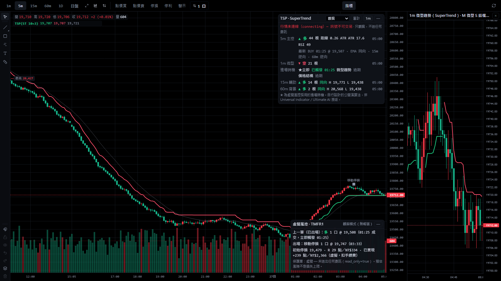

# Trend Signal Pro 使用說明

Shioaji Pro 的原生內建指標：5m 紅綠趨勢線與 BUY／SELL 訊號為核心，1m 只決定進出場時機，15m／60m
只做輔助判斷；另有四週期面板、虛擬風控（SL／1R／2R／3R、保本、移動停損）與訊號審計。

- **只觀察，不送任何委託**（`read_only = true`、`auto_entry = false`、`auto_exit = false`）。虛擬部位只是計畫，
  不是委託，也不是損益保證；預估風險不是損失上限。
- 自行設計的公開演算法（SuperTrend／Donchian／KAMA），**不是 Universal Indicator／Ultimate AI 的原版或複製**，
  沒有 AI 模型。
- 設計與量測依據：[重設計提案](design/trend-signal-pro-v1-redesign.md)、[量測報告](research/trend-signal-algorithms-2026-10.md)。



## 加入圖表

1. K 線面板工具列 →「指標」→ 搜尋 `TSP` 或「趨勢訊號」→ 點「Trend Signal Pro 趨勢訊號」。
2. 設定視窗可先調參數（圖上即時預覽），按「確定」加入。
3. legend 顯示 `TSP(ST 10×3)`；眼睛圖示可隱藏，隱藏時面板與標記一起消失。

同一張圖以第一個可見的 TSP 實例驅動面板與標記。組合商品沒有單一合約的 1m K 棒，不支援。

## 畫面

| 位置 | 內容 |
|---|---|
| 主圖 | 5m 趨勢線（綠＝多、紅＝空，翻轉處斷開）、5m EMA 註記線（虛線）、BUY／SELL 箭頭、風控採用模式的進場點（M／S／K）、虛擬出場點、持倉中的 SL／1R／2R／3R 與動態停損（橘色階梯線） |
| 右上 Dashboard | 5m 主控（方向、持續根數、距線 ATR、ATR、RSI、最新訊號與註記）、1m 微型趨勢、三種進場時機狀態（★＝風控採用）、15m 輔助／60m 背景（同向／逆向、近 20 根高低點）；高週期都與 5m 反向時顯示「高週期逆向」 |
| 右下虛擬風控 | 方向、口數、成交價、初始停損與依據、R（點數／新臺幣）、1R／2R／3R、保本價、目前停損、未實現／已實現（虛擬，扣手續費）、警告 |
| 右側 1m 小圖 | Dashboard「1m」按鈕開關；最近 120 根 1m、1m 微型趨勢線、5m 訊號與 M／S 進場點 |
| 審計 | 事件、5m 訊號、進場時機、虛擬部位四個分頁；「複製 JSON」「下載 JSON」可離線檢查 |

狀態徽章：`LIVE`（行情連線中）、`行情未連線 — 訊號不可交易`、`休市`、`資料延遲 N 秒`（盤中超過 180 秒沒有新的已收 1m）、
`無新資料（可能休市）`（盤中時段超過 30 分鐘沒有資料，例如國定假日；時段判定不知道假日）。
Dashboard 與虛擬風控面板都可按「—」收合。

切換主圖 1m／5m／15m／60m 不會改變任何訊號：所有計算都來自同一份固定 20 天的 1m 資料，主圖週期只決定標記落在哪一根 K 棒。
日 K 不畫趨勢線與標記（Dashboard 照常）。開「僅日盤」時，夜盤的訊號沒有對應的 K 棒，不畫。

## 訊號規則

- **只用已收 K 棒**：1m label ≤ asOf 才算已收；asOf = max(最後一筆成交的交易所時間, 本機時鐘 − 10 秒)。
  5m／15m／60m 由同一份 1m 以主圖相同的規則聚合，桶收完（或該盤收盤）才算已收。進行中的 K 棒不參與任何訊號。
- **BUY／SELL**：已收 5m 的趨勢方向由空轉多＝BUY、由多轉空＝SELL，嚴格交替；產生後不再改變。
- **暖身**：資料起點後的 150 根（SuperTrend 15 × ATR 週期、KAMA 5 × 慢速常數）輸出「未知」，不產生訊號。
- **訊號 ID**：`計算版本#趨勢參數指紋 | 商品 | 月份 | 盤別 | 5m | 收棒時間 | BUY/SELL`。改進場或風控參數不改訊號 ID。
- **註記（不影響訊號）**：EMA21 同向／逆向、15m／60m 同向／逆向。

## 1m 進場時機

每個 5m 訊號後 3 根 5m 內（不跨盤；反向訊號一確認即結束）各模式獨立判定，結果並列在 Dashboard 與審計：

| 模式 | 規則 | 整年 TMF 量測（SuperTrend） |
|---|---|---|
| **立即**（預設，比較基準） | 5m 收棒後下一根 1m 開盤 | 觸發 99%；其餘落在收盤最後一根 |
| **微型趨勢** MICRO_TREND | 1m SuperTrend（倍數 1.0）訊號後由反向轉回同向 | 觸發 56%、平均進場價 −0.18 ATR、避開 58% 的 30 分鐘內反向訊號、錯過 42% 大行情 |
| **價格結構** PRICE_STRUCTURE | 訊號後的回檔轉折（左右各 2 根，右側收盤後才確認）確認後，收盤突破回檔起點 | 觸發 38%、平均 −0.89 ATR、避開 84%、錯過 53% |
| 舊假說 KD（可選） | EMA9／VWAP 回測＋KD 交叉，參數固定 | 觸發 64%、平均 −0.24 ATR、錯過 31% |

確認型時機比隨機更常避開失敗訊號，但進場較晚、價格較差並錯過大量大行情；淨效果取決於損益分佈，沒有結論。
「進場｜風控採用」參數決定虛擬部位用哪一種。

出場：5m 確認反向 → 下一根 1m 開盤平倉，不等 1m；停損、保本、移動停損觸價即出（含進行中的 K 棒），永遠獨立有效；
持倉中 1m 微型趨勢反向只顯示警告。

## 虛擬風控

- 初始停損：多單 `min(最近 5 根 1m 確認擺動低點 − 1 tick, 進場 − 1.5 × 1m ATR14)`，空單鏡像；R 以成交價重新定價後固定。
- 每筆預算 NT$1,000（全部口數合計，含來回手續費與滑價緩衝）；超過預算減口數，連 1 口都不行時拒絕並說明原因。
- 每點價值：API 的 `multiplier` 優先，其次已知根代碼（TMF 10、MXF 50、TXF 200）；都沒有就不產生風控計畫。
- +1R：停損移到保本（成交價 + 來回成本折算點數），下一根生效；+2R：啟動移動停損、多口時出第 1 層；+3R：多口時出第 2 層。
- 移動停損：`max(舊停損, 5m 趨勢線 − 1 tick, 入場後最高 − 1.2 × 5m ATR14)`，只往有利方向；KAMA 的線不是停損價位，只用 ATR 項。
- 口數分層：1 口追蹤（可改 2R／3R 全出）、2 口 2R＋追蹤、3 口 2R＋3R＋追蹤、4 口以上可自訂；不產生零口或超賣。
- 虛擬成交：下一根 1m 開盤 ± 滑價；停損跳空以開盤價成交；同一根同時觸及停損與目標時停損優先。

## 模式

| 模式 | 行為 |
|---|---|
| 觀察（預設） | 只顯示 |
| 模擬警示 | 行情 LIVE、盤中、3 分鐘內的新訊號／進場／成交／出場發 App 通知；已提醒過的不重複（切週期、重開都一樣） |
| 模擬交易 | 停用（P4 未授權） |
| 正式交易 | 停用（V1 不開放） |

## 參數

設定視窗「輸入」分頁，依前綴分組（括號內為預設）：

- 趨勢：演算法（0 SuperTrend）、SuperTrend ATR 週期（10）／倍數（3，小＝快）、Donchian 週期（20）、KAMA 效率比週期（10）／快速（2）／慢速（30）／翻轉遲滯（0.3 × ATR）。
- 註記：EMA 週期（21，只標示）。
- 進場：風控採用（0 立即）、窗口（3 根 5m）、1m 微型趨勢倍數（1）、結構轉折左／右（2／2）、最小回檔（0.5 × 1m ATR）。
- 風控：預算（NT$1,000）、單邊手續費（NT$12）、滑價緩衝（1 tick／邊）、口數上限（1）、擺動點 K 棒數（5）、停損 ATR 倍數（1.5）、移動停損 ATR 倍數（1.2）、單口出場（1 追蹤）、多口分配（0 規格表）、自訂 2R／3R 口數。

不同商品的手續費請自行覆寫（預設值是 TMF 的單邊 NT$12）。

## 已知限制

- 歷史固定載入 20 個日曆日的 1m；60m 需約 8 個交易日暖身才有方向。
- 即時 1m 由 SSE 逐筆成交組成；「更新歷史」會改以伺服器 1m 為準重算。
- 換月：連續月代碼（如 TMFR1）的 1m 由伺服器提供，換月跳空會反映在指標上；訊號 ID 記錄當時的月份。
- 量測只涵蓋 TMF 一年（強多頭），不代表其他商品或盤勢；虛擬部位不含真實成交、部分成交或委託回報。
- 既有內建「SuperTrend 超級趨勢」指標的多空兩線在翻轉處會互相連線（lightweight-charts v5 的折線不因 whitespace 斷開，
  改動前即存在）；Trend Signal Pro 已用點顏色斷線，內建指標未修改。

## Windows 建置與使用

這個 repo 是開源的 Web 版終端。官方桌面版安裝檔（.msi）內含的是上游前端，看不到這個分支的 Trend Signal Pro；
桌面版需要私有 repo `shioaji-pro-desktop` 與簽章金鑰才能建置，本 fork 無法自行產出。要在桌面版使用，需把本分支
送 PR 到上游 `Sinotrade/shioaji-pro-app`，由維護者合併發版。以下是在 Windows 上使用 Web 版的方式。

前置：

1. Node.js 22 LTS、Git、pnpm 10。
2. 一個本機 Shioaji server（二擇一，建議先用模擬環境）：
   - 已安裝並登入的 Shioaji Pro 桌面版：內建 server 在 `127.0.0.1:21322`（Web 版預設就連這裡）。
   - Shioaji CLI 1.7.8（與 repo 的 `SHIOAJI_VERSION` 相同）：`uv tool install shioaji==1.7.8`，在 repo 根目錄
     `.env` 填 `SJ_API_KEY`／`SJ_SEC_KEY`，執行 `shioaji server start`（預設模擬環境、port 8080）。

**CLI**（Windows PowerShell）

```powershell
winget install OpenJS.NodeJS.LTS
winget install Git.Git
npm install -g pnpm@10
git clone https://github.com/Zongc-spec/shioaji-pro-app.git
cd shioaji-pro-app
git checkout codex/trend-signal-pro-v1
pnpm install --frozen-lockfile
pnpm test
pnpm build
# 連 Shioaji Pro 桌面版內建 server（127.0.0.1:21322）
pnpm dev
```

使用 CLI server（port 8080）時，改用：

**CLI**（Windows PowerShell）

```powershell
$env:VITE_API_TARGET = 'http://127.0.0.1:8080'
pnpm dev
```

瀏覽器開 `http://127.0.0.1:5173`，在 K 線面板加入 Trend Signal Pro。

也可以把 build 結果上傳給 CLI server 代管（依 README「Deploy as a Shioaji custom app」；上傳的 App 存在 server
記憶體，server 重啟後要重傳；此流程本次未在本機實測）：

**CLI**（Windows PowerShell）

```powershell
$env:VITE_BASE = '/apps/shioaji-pro-app/'
pnpm build
$files = Get-ChildItem dist -File | ForEach-Object { '-F'; "files=@$($_.FullName)" }
curl.exe -X POST http://127.0.0.1:8080/api/v1/apps/shioaji-pro-app @files
# 開啟 http://127.0.0.1:8080/apps/shioaji-pro-app/index.html
```

在 WSL 內開發時，WSL 預設的 NAT 網路連不到 Windows 端只聽 `127.0.0.1` 的桌面版 server；請在 WSL 內另跑 CLI server，
Windows 瀏覽器開 `http://localhost:5173`（WSL 會把 localhost 轉給 Windows）：

**WSL**

```bash
cd ~/shioaji-pro-trend-v1
npx -y pnpm@10 install --frozen-lockfile
VITE_API_TARGET=http://127.0.0.1:8080 npx -y pnpm@10 dev
```

不連任何 server、只看畫面時，可用回放展示頁（合成資料；`TSP_DEMO_DATA` 可指向自備的 kbars JSON）：

**WSL**

```bash
cd ~/shioaji-pro-trend-v1
npx vite --config scripts/tsp-demo/vite.config.ts --port 5298 --host 127.0.0.1
# Windows 瀏覽器開 http://localhost:5298/?theme=dark&replayAt=2026-08-27T05:00:30&mini=1
```
